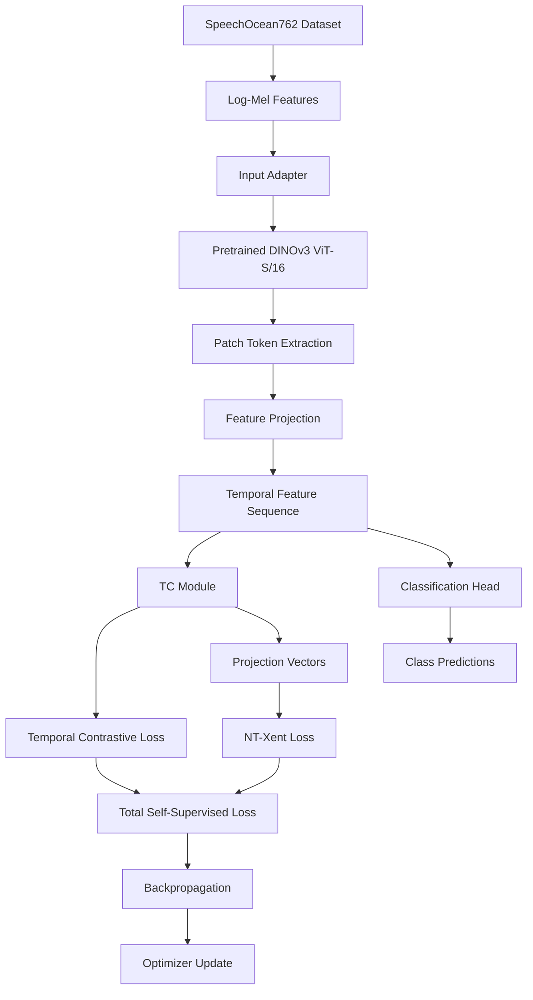
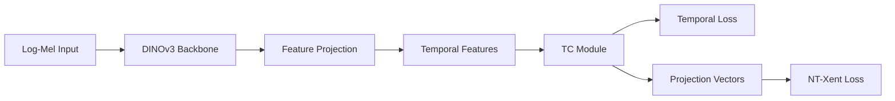
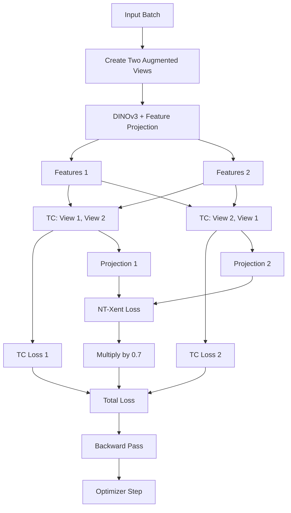

# DINOv3 + TS-TCC for SpeechOcean762

A self-supervised learning framework that integrates a pretrained DINOv3 Vision Transformer with the TS-TCC time-series contrastive learning framework for speech feature representation.

## Table of Contents

1. [Project Overview](#1-project-overview)
2. [System Overview](#2-system-overview)
3. [Environment](#3-environment)
4. [Setup](#4-setup)
5. [Run and Verify](#5-run-and-verify)
6. [Usage and Training Modes](#6-usage-and-training-modes)
7. [DINOv3 Integration Details](#7-dinov3-integration-details)
8. [Total Loss Function and Parameter Updates](#8-total-loss-function-and-parameter-updates)
9. [Model Training and Evaluation](#9-model-training-and-evaluation)
10. [Checkpoints and Outputs](#10-checkpoints-and-outputs)
11. [Troubleshooting](#11-troubleshooting)
12. [Limitations and Future Improvements](#12-limitations-and-future-improvements)
13. [References](#13-references)

---

## 1. Project Overview

### 1.1 What is this project?

This project combines **DINOv3**, a pretrained Vision Transformer, with **TS-TCC**, a time-series contrastive learning framework.

The main goal is to study whether pretrained visual features can be adapted to speech-related time-series data while keeping the temporal contrastive learning process of TS-TCC.

Instead of using the original CNN encoder, the modified framework uses DINOv3 to extract features from Log-Mel representations of speech signals.

### 1.2 Main objectives

- Replace the original CNN encoder with a pretrained DINOv3 backbone.
- Convert Log-Mel features into an input format accepted by DINOv3.
- Transform visual patch features into a temporal feature sequence.
- Keep the Temporal Contrasting (TC) module for temporal representation learning.
- Combine temporal contrastive losses with an NT-Xent contrastive loss.
- Support self-supervised training and downstream classification.
- Evaluate the learned representations on the SpeechOcean762 dataset.

### 1.3 Main contributions

| Component | Description |
|---|---|
| Pretrained backbone | DINOv3 ViT-S/16 |
| Input representation | Log-Mel features |
| Feature adapter | Image conversion and feature projection |
| Temporal learning | TS-TCC Temporal Contrasting module |
| Self-supervised objective | Two temporal losses and NT-Xent |
| Classification | Linear classification head |
| Training control | Optional backbone freezing |
| Model evaluation | Validation and test evaluation |

### 1.4 Important note

DINOv3 is originally designed for visual representation learning. In this project, Log-Mel features are converted into image-like tensors so that DINOv3 can process them.

This is an adaptation of a visual backbone to speech-related features. It does not mean that DINOv3 was originally trained as a speech recognition model.

---

## 2. System Overview

### 2.1 Overall architecture

The complete pipeline consists of five main stages:

1. Input preparation.
2. DINOv3 feature extraction.
3. Feature projection.
4. Temporal contrastive learning.
5. Classification and evaluation.

### 2.2 Architecture diagram



The classification head is used for downstream classification. During self-supervised training, the total contrastive loss does not automatically train the classification head unless the code explicitly connects that head to the training objective.

### 2.3 Data flow and tensor shapes

The following table describes the expected tensor shapes in the integration.

| Stage | Operation | Expected shape |
|---|---|---|
| Input | Log-Mel features | `(B, 64, 1536)` |
| Image adapter | Resize and convert channels | `(B, 3, 224, 224)` |
| DINOv3 | Extract hidden states | `(B, 201, 384)` |
| Patch extraction | Remove CLS and register tokens | `(B, 196, 384)` |
| Patch grid | Arrange tokens into a grid | `(B, 14, 14, 384)` |
| Temporal reduction | Average one grid dimension | `(B, 14, 384)` |
| Feature projection | Linear, LayerNorm and GELU | `(B, 14, 128)` |
| TC input | Transpose dimensions | `(B, 128, 14)` |
| Classification head | Pool and classify | `(B, 3)` |

Here, `B` represents the batch size.

The token shape assumes the selected DINOv3 model returns one CLS token, four register tokens and 196 patch tokens for a 224 × 224 input with patch size 16. The actual output shape should be checked against the installed model and configuration.

---

## 3. Environment

### 3.1 Requirements

The project uses Python and PyTorch for model training.

The main dependencies include:

- Python
- PyTorch
- Transformers
- NumPy
- scikit-learn
- Other dependencies required by the original TS-TCC implementation

The exact versions should be taken from the project's dependency files or the environment in which the experiments were tested.

### 3.2 Hardware

GPU training is recommended because DINOv3 adds a pretrained Transformer backbone to the original pipeline.

A CUDA-compatible NVIDIA GPU can reduce training time. CPU execution may be useful for debugging, but can be significantly slower.

### 3.3 Check the environment

```bash
python --version
python -c "import torch; print(torch.__version__)"
python -c "import torch; print(torch.cuda.is_available())"
```

To check the Transformers installation:

```bash
python -c "import transformers; print(transformers.__version__)"
```

If CUDA is available, check the GPU name:

```bash
python -c "import torch; print(torch.cuda.get_device_name(0) if torch.cuda.is_available() else 'CPU')"
```

---

## 4. Setup

### 4.1 Clone the repository

```bash
git clone https://github.com/tranvanh10205-ctrl/CD_TH2.git
cd CD_TH2
```

### 4.2 Create a virtual environment

On Windows:

```powershell
python -m venv .venv
.\.venv\Scripts\Activate.ps1
```

On Linux or macOS:

```bash
python3 -m venv .venv
source .venv/bin/activate
```

### 4.3 Install dependencies

If the project contains a `requirements.txt` file:

```bash
pip install -r requirements.txt
```

Otherwise, install the dependencies specified by the project configuration and the original TS-TCC implementation.

**Important:** The dependency list should be checked against the actual source code before reproducing the experiments.

### 4.4 Prepare the dataset

Prepare the SpeechOcean762 dataset and its corresponding Log-Mel features according to the dataset preprocessing pipeline used by the project.

Check that:

- The input tensors have the expected dimensions.
- Training, validation and test splits are separated correctly.
- Labels are mapped to the expected classes.
- The data loader returns tensors compatible with the selected model.

The exact dataset directory and preprocessing commands depend on the local project configuration.

---

## 5. Run and Verify

### 5.1 Start training

The exact command depends on the entry point and argument parser in the checked-out source code.

For the DINOv3 integration, the main training entry point is described as:

```bash
python main_dinov3.py
```

If the implementation requires command-line arguments, provide the dataset path, training mode, device and experiment settings supported by the actual script.

Do not assume that every argument from the original TS-TCC `main.py` is also supported by `main_dinov3.py`.

### 5.2 Verify the forward pass

Before starting a complete training run, verify that the model can process one batch.

Check the following tensors:

- Input Log-Mel features.
- DINOv3 hidden states.
- Patch tokens.
- Projected temporal features.
- Classification logits.
- Self-supervised loss.

Expected output shapes include:

```text
Input features:       (B, 64, 1536)
Projected features:   (B, 128, 14)
Classification logits:(B, 3)
```

The exact shape of intermediate tensors depends on the implementation.

### 5.3 Verify the loss

During self-supervised training, the loss should be a finite scalar.

In PyTorch, the following check can be used:

```python
if not torch.isfinite(loss):
    raise RuntimeError("The training loss is not finite.")
```

Also check that gradients are present for the parameters that are expected to be trainable.

A successful forward pass does not guarantee that the optimizer updates the intended parameters. The trainable parameter list should be inspected separately.

---

## 6. Usage and Training Modes

The available training modes depend on the implementation.

### 6.1 Self-supervised learning

Self-supervised training learns representations from different augmented views of the same input without directly using class labels in the contrastive objective.

The two augmented views are passed through the encoder and temporal model. Their losses are combined into a total self-supervised loss.

### 6.2 Supervised classification

Supervised classification uses labeled data to train a classification head.

The usual objective is Cross-Entropy:

\[
\mathcal{L}_{CE}
=
-\frac{1}{B}\sum_{i=1}^{B}
\log p_{i,y_i}
\]

where:

- \(B\) is the batch size.
- \(p_{i,y_i}\) is the predicted probability assigned to the correct class.
- \(y_i\) is the ground-truth class.

PyTorch's `CrossEntropyLoss` accepts raw logits and class indices. A separate softmax operation is not required before calling it.

### 6.3 Linear evaluation

Linear evaluation measures the quality of pretrained or self-supervised features by training a classification head while keeping the feature extractor fixed.

If the implementation follows this approach:

- The DINOv3 backbone is frozen.
- The feature projection is frozen.
- The classifier is trained.
- The optimizer updates only the classifier parameters.

These settings must be verified in the actual training code.

---

## 7. DINOv3 Integration Details

This section explains the main architectural changes required to integrate DINOv3 into TS-TCC.

### 7.1 Main files

The integration is described using the following file structure.

| File | Main responsibility |
|---|---|
| `models/dinov3_model.py` | DINOv3 backbone, input adapter, feature projection and classifier |
| `main_dinov3.py` | Configuration, model creation, optimizer setup and training entry point |
| `trainer/trainer_dinov3.py` | Training loop, contrastive losses, evaluation and checkpoint saving |
| `models/TC.py` | Temporal Contrasting module inherited from TS-TCC |
| `config_files/` | Dataset and model configuration, if present |

The file names above must match the source files in the actual repository before this table is used as a verified code map.

### 7.2 Step 1: Load the pretrained DINOv3 model

The model initialization is described by the following pattern:

```python
self.backbone = AutoModel.from_pretrained(model_id)
```

The default model ID described in the current project documentation is:

```text
facebook/dinov3-vits16-pretrain-lvd1689m
```

This loads a pretrained DINOv3 ViT-S/16 model through the Hugging Face Transformers interface.

The backbone provides contextual visual features. The project then adapts these features to a temporal learning task.

The model name and loading method should be checked against the actual source code and installed Transformers version.

### 7.3 Step 2: Freeze or unfreeze the backbone

A typical freezing implementation is:

```python
if self.freeze_backbone:
    for parameter in self.backbone.parameters():
        parameter.requires_grad = False
```

When the backbone is frozen:

- The pretrained DINOv3 parameters do not receive optimizer updates.
- The forward pass still computes DINOv3 features.
- Trainable layers after the backbone can still learn.
- Memory and training requirements may be reduced, depending on how the forward pass is implemented.

When the backbone is unfrozen, gradients can update its parameters if the loss depends on its output and the optimizer includes those parameters.

Freezing and unfreezing are different from calling `model.eval()`. Evaluation mode controls layers with training-dependent behavior, while `requires_grad` controls whether parameters receive gradients.

### 7.4 Step 3: Convert Log-Mel features into images

DINOv3 expects image-like inputs.

The speech feature tensor is described as:

\[
X \in \mathbb{R}^{B \times 64 \times 1536}
\]

The input adapter converts this tensor into:

\[
X_{\mathrm{image}}
\in \mathbb{R}^{B \times 3 \times 224 \times 224}
\]

The main operations are:

1. Add a channel dimension.
2. Resize the feature representation to 224 × 224.
3. Repeat or expand the single channel to three channels.
4. Normalize the input according to the implementation.

This is a practical conversion step. It does not turn the Log-Mel representation into a natural photograph; it only makes the tensor compatible with the visual backbone.

### 7.5 Step 4: Extract patch tokens

For a 224 × 224 input and patch size 16, the patch grid is:

\[
\frac{224}{16}\times\frac{224}{16}
=14\times14=196
\]

The output contains the special tokens and patch tokens used by the selected DINOv3 architecture.

The integration removes the CLS token and four register tokens according to the described implementation:

```python
outputs = self.backbone(pixel_values=images)
tokens = outputs.last_hidden_state
patch_tokens = tokens[:, 1 + 4:, :]
```

The remaining patch tokens have the expected shape:

\[
(B,196,384)
\]

Here, 384 is the hidden dimension of ViT-S/16.

### 7.6 Step 5: Convert patch features into a temporal sequence

The patch tokens are arranged into a two-dimensional grid:

\[
(B,196,384)
\rightarrow
(B,14,14,384)
\]

The model averages one spatial dimension:

\[
(B,14,14,384)
\rightarrow
(B,14,384)
\]

A feature projection then maps the hidden dimension from 384 to 128:

```python
sequence = patch_grid.mean(dim=1)
sequence = self.feature_projection(sequence)
features = sequence.transpose(1, 2).contiguous()
```

The result is:

\[
Z\in\mathbb{R}^{B\times128\times14}
\]

This representation is designed to match the input format expected by the TC module.

**Important limitation:** Averaging one grid dimension reduces spatial information. The resulting sequence should not automatically be interpreted as a perfectly time-aligned speech sequence. It is a temporal representation constructed from image-like Log-Mel features.

### 7.7 Step 6: Connect DINOv3 to TS-TCC

The integration replaces the original encoder while keeping the temporal learning component.

The overall connection is:



The main architectural change is the feature extractor and its input/output adapter. The TC module continues to perform temporal contrastive learning on the projected sequence.

### 7.8 Step 7: Connect the classifier

The classification head receives features from the DINOv3 model and produces class logits:

\[
Z\rightarrow\text{Pooling}
\rightarrow\text{Dropout}
\rightarrow\text{Linear}
\rightarrow\text{Logits}
\]

For a three-class task, the expected output shape is:

\[
\text{Logits}\in\mathbb{R}^{B\times3}
\]

The classification head is trained using labeled data when the selected training mode uses supervised classification.

---

## 8. Total Loss Function and Parameter Updates

This section describes how the loss is constructed, how gradients flow through the network, and which parameters can be updated.

The exact implementation should be verified in `trainer/trainer_dinov3.py` before reporting experimental results.

### 8.1 Two augmented views

Self-supervised learning starts with two augmented views of the same input:

\[
X_1=\operatorname{Aug}_1(X)
\]

\[
X_2=\operatorname{Aug}_2(X)
\]

The two views are processed by the DINOv3 model:

\[
Z_1=f_\theta(X_1)
\]

\[
Z_2=f_\theta(X_2)
\]

where:

- \(f_\theta\) is the DINOv3 encoder and feature projection.
- \(\theta\) represents the parameters of these components.
- \(Z_1\) and \(Z_2\) are temporal feature sequences.

The same model weights are used for both views.

### 8.2 Temporal contrastive losses

The TC module processes the two feature sequences in both orders:

```python
tc_loss1, projection1 = temporal_model(features1, features2)
tc_loss2, projection2 = temporal_model(features2, features1)
```

This produces:

\[
\mathcal{L}_{TC}^{(1)}
=
\mathcal{L}_{TC}(Z_1,Z_2)
\]

\[
\mathcal{L}_{TC}^{(2)}
=
\mathcal{L}_{TC}(Z_2,Z_1)
\]

The two terms represent temporal contrastive objectives with reversed input order.

Using both directions allows the objective to consider both feature sequences as the reference and the comparison sequence.

The internal calculation of each TC loss is defined by the TC module. Its exact formula should be taken from `models/TC.py`, rather than inferred only from the trainer.

### 8.3 NT-Xent contrastive loss

The temporal model also produces projection vectors for the two views:

\[
P_1=g(Z_1,Z_2)
\]

\[
P_2=g(Z_2,Z_1)
\]

Here, \(g\) represents the projection operation implemented by the TC module.

The NT-Xent loss encourages representations of corresponding views to be similar relative to other samples in the batch.

For normalized projection vectors \(u_i\) and \(u_j\), their temperature-scaled similarity is:

\[
s_{ij}=
\frac{u_i^\top u_j}{\tau}
\]

where \(\tau\) is the temperature parameter.

For a positive pair \(i,j\), the contrastive objective can be written as:

\[
\ell_{i,j}
=
-\log
\frac{\exp(s_{ij})}
{\sum_{k\ne i}\exp(s_{ik})}
\]

The denominator contains the other candidates in the contrastive batch. The exact reduction and pair construction depend on the implementation of `nt_xent_loss`.

### 8.4 Total self-supervised loss

The total loss described for this integration is:

\[
\boxed{
\mathcal{L}_{\mathrm{total}}
=
\mathcal{L}_{TC}^{(1)}
+
\mathcal{L}_{TC}^{(2)}
+
0.7\mathcal{L}_{NT\text{-}Xent}
}
\]

The three components are:

| Loss component | Role | Weight |
|---|---|---:|
| \(\mathcal{L}_{TC}^{(1)}\) | Temporal contrastive learning, first order | 1.0 |
| \(\mathcal{L}_{TC}^{(2)}\) | Temporal contrastive learning, reversed order | 1.0 |
| \(\mathcal{L}_{NT\text{-}Xent}\) | Contrastive learning between projection vectors | 0.7 |

The coefficient 0.7 is the weighting factor described for this integration. It is a hyperparameter, not a value learned automatically by the optimizer.

The total loss balances temporal representation learning and projection-level contrastive learning.

### 8.5 Where is the total loss calculated?

The described code organization places the loss calculation in:

`trainer/trainer_dinov3.py`

The relevant functions are expected to include:

- `nt_xent_loss`
- `combined_self_supervised_loss`
- `evaluate`
- The training loop inside `Trainer_DINOv3`

The conceptual implementation is:

```python
tc_loss1, projection1 = temporal_model(features1, features2)
tc_loss2, projection2 = temporal_model(features2, features1)

ntxent = nt_xent_loss(
    projection1,
    projection2,
    temperature=temperature,
)

total_loss = tc_loss1 + tc_loss2 + 0.7 * ntxent
```

This snippet illustrates the documented loss structure. Variable names, function arguments and return values must be checked against the actual source.

### 8.6 Total loss flow diagram



The optimizer step updates only parameters that are trainable and included in the optimizer. Frozen parameters remain unchanged.

### 8.7 What happens during backpropagation?

The training process can be described in six steps.

**Step 1: Forward pass**

The two augmented views pass through DINOv3 and the feature projection. Their temporal features are sent to the TC module.

**Step 2: Loss calculation**

The training code calculates the two TC losses and the NT-Xent loss, then combines them into one scalar.

**Step 3: Gradient calculation**

PyTorch calculates gradients of the total loss with respect to the trainable parameters connected to that loss.

For a trainable parameter \(\theta\):

\[
\nabla_\theta\mathcal{L}_{total}
=
\nabla_\theta\mathcal{L}_{TC}^{(1)}
+
\nabla_\theta\mathcal{L}_{TC}^{(2)}
+
0.7\nabla_\theta\mathcal{L}_{NT\text{-}Xent}
\]

This expression follows from the linear combination of loss terms, provided that all three terms depend on \(\theta\).

**Step 4: Gradient reset**

The optimizer's gradients are cleared before the next update, usually using:

```python
optimizer.zero_grad()
```

**Step 5: Backward pass**

The gradients are calculated using:

```python
total_loss.backward()
```

**Step 6: Parameter update**

The optimizer updates its registered trainable parameters:

```python
optimizer.step()
```

The actual update rule depends on the selected optimizer and its settings, such as learning rate and weight decay.

### 8.8 Which parameters are updated?

The answer depends on the training mode and freezing configuration.

| Parameter group | Self-supervised training | Linear evaluation |
|---|---|---|
| DINOv3 backbone | Updated if unfrozen and included in optimizer | Frozen |
| Feature projection | Updated if trainable and included in optimizer | Frozen if using strict linear evaluation |
| TC module | Updated if included in the optimizer | Usually not updated |
| Classification head | Not directly trained by contrastive loss | Updated |
| Loss coefficient 0.7 | Not updated | Not updated |

This table describes the intended behavior. The actual parameter groups must be confirmed from the optimizer construction and training-mode logic.

### 8.9 Important distinction: model parameters versus loss weights

The coefficient 0.7 is a fixed scalar in the stated objective.

It is not a neural network parameter unless the implementation explicitly defines it as a trainable parameter.

For the fixed-weight objective:

\[
\mathcal{L}_{total}
=
\mathcal{L}_{TC}^{(1)}
+
\mathcal{L}_{TC}^{(2)}
+
0.7\mathcal{L}_{NT\text{-}Xent}
\]

the optimizer updates the model parameters through gradients. It does not update the coefficient 0.7.

### 8.10 What changes compared with the original TS-TCC encoder?

The primary architectural change is the encoder and feature conversion pipeline.

| Aspect | Original TS-TCC approach | DINOv3 integration |
|---|---|---|
| Feature extractor | Original CNN encoder | Pretrained DINOv3 backbone |
| Input handling | Time-series augmentation and CNN input | Log-Mel to image-like tensor |
| Feature conversion | CNN feature sequence | Patch tokens and feature projection |
| Temporal module | TC module | TC module retained |
| Contrastive objective | Temporal and contextual contrastive learning | Two TC terms and weighted NT-Xent as described |
| Classification | Original classifier design | Classifier adapted to projected features |

The total loss must be compared with the original repository's trainer to determine whether the loss formula itself changed or whether only the encoder was replaced. A statement about the original loss should not be made without checking its implementation.

### 8.11 Supervised Cross-Entropy is a separate objective

During supervised classification, the loss is usually:

\[
\mathcal{L}_{CE}
=
-\frac{1}{B}\sum_{i=1}^{B}
\log p_{i,y_i}
\]

The model receives classification logits, compares them with the ground-truth labels and calculates the loss.

This objective is different from the self-supervised contrastive objective.

Do not automatically add Cross-Entropy to the contrastive total loss. A combined objective such as

\[
\mathcal{L}
=
\mathcal{L}_{total}
+
\lambda_{CE}\mathcal{L}_{CE}
\]

is appropriate only if the actual training code explicitly implements joint self-supervised and supervised optimization.

---

## 9. Model Training and Evaluation

### 9.1 Validation

Validation is used to monitor model behavior during training and select a checkpoint.

The implementation may evaluate:

- Self-supervised validation loss.
- Classification loss.
- Classification accuracy.
- Other task-specific metrics.

The correct metric depends on the training mode.

### 9.2 Test evaluation

After training, the selected checkpoint is evaluated on the test set.

The test set should not be used to select hyperparameters or repeatedly choose the best checkpoint, because this can lead to an overly optimistic estimate of generalization performance.

### 9.3 Recommended evaluation metrics

For a classification task, useful metrics include:

| Metric | Purpose |
|---|---|
| Accuracy | Overall proportion of correct predictions |
| Precision | Reliability of positive predictions |
| Recall | Ability to identify positive examples |
| F1-score | Balance between precision and recall |
| Confusion matrix | Shows correct and incorrect class predictions |

For multiclass classification, the averaging method used for precision, recall and F1-score should be stated explicitly.

### 9.4 Reproducibility

For a fair comparison between the original and modified models:

- Use the same dataset split.
- Keep the preprocessing pipeline consistent where appropriate.
- Record the random seed.
- Record optimizer settings.
- Record the backbone freezing configuration.
- Record the selected checkpoint.
- Report the evaluation protocol and metrics.

No performance improvement should be claimed until supported by actual experiment results.

---

## 10. Checkpoints and Outputs

The integration documentation describes two checkpoint names:

- `ckp_best.pt`: checkpoint selected using validation performance.
- `ckp_last.pt`: checkpoint from the last training epoch.

The actual save directory depends on the experiment configuration.

A complete experiment record should include:

- Model configuration.
- Dataset and split information.
- Training mode.
- Random seed.
- Optimizer settings.
- Training and validation logs.
- Best checkpoint.
- Final test metrics.

The checkpoint should contain the state needed to reproduce the intended evaluation. Depending on the implementation, this may include the encoder, feature projection, TC module, classifier, optimizer state and epoch information.

---

## 11. Troubleshooting

### 11.1 DINOv3 model loading fails

Possible causes:

- Incorrect model ID.
- Unsupported Transformers version.
- Missing internet access or cached weights.
- Model access or weight-loading issues.

Check the model ID and the loading code before changing the architecture.

### 11.2 Input tensor shape is incorrect

Confirm that the data loader returns the expected Log-Mel dimensions and that the adapter produces the correct number of image channels.

Inspect the shapes at each stage of the forward pass.

### 11.3 Patch token count is incorrect

For a 224 × 224 image and patch size 16, the expected patch grid is 14 × 14.

The number of special tokens depends on the model configuration. Verify the actual output before removing tokens by index.

### 11.4 Loss becomes NaN or infinite

Check:

- Input data for invalid values.
- Learning rate.
- Temperature in NT-Xent.
- Loss components individually.
- Gradient magnitudes.
- Numerical stability in the contrastive calculation.

Check each loss term before combining them into the total objective.

### 11.5 GPU memory usage is too high

Possible approaches include:

- Reducing batch size.
- Freezing the DINOv3 backbone.
- Using supported mixed precision.
- Reducing unnecessary tensor retention.
- Using gradient accumulation if compatible with the training loop.

### 11.6 Parameters do not update

Check:

- Whether `requires_grad` is enabled.
- Whether the parameter is included in the optimizer.
- Whether the loss depends on that parameter.
- Whether the training loop calls `backward()` and `step()`.
- Whether gradients are unexpectedly zero or absent.

A frozen backbone can produce valid features without updating its pretrained weights.

### 11.7 The classification head does not learn

Confirm that the selected training mode uses labeled data and calculates a classification loss. The self-supervised contrastive objective alone does not directly optimize classification logits unless the classification head is connected to that objective.

---

## 12. Limitations and Future Improvements

### 12.1 Limitations

- DINOv3 is a visual backbone, so Log-Mel input conversion introduces a difference between pretraining data and the target representation.
- Spatial patch aggregation may remove information that could be useful for speech-related temporal modeling.
- The quality of the learned representation depends on the input preprocessing and augmentation strategy.
- A frozen backbone limits adaptation to the target dataset.
- Training results depend on the dataset split, optimizer settings and training configuration.

### 12.2 Future improvements

Possible future work includes:

- Comparing frozen and fine-tuned DINOv3 backbones.
- Testing different feature projection dimensions.
- Comparing the mean-based patch aggregation with other pooling methods.
- Studying the effect of the NT-Xent coefficient.
- Comparing the modified architecture with the original TS-TCC baseline.
- Evaluating different augmentation strategies.
- Reporting results over multiple random seeds.

These are possible research directions, not claims that the current implementation already supports them.

---

## 13. References

1. **TS-TCC: Time-Series Representation Learning via Temporal and Contextual Contrasting.** Refer to the original paper and repository for the baseline architecture and training objective.

2. **DINOv3: Self-Supervised Learning for Visual Features.** Refer to the official repository for the pretrained models, architecture and usage requirements:  
   https://github.com/facebookresearch/dinov3

3. **Hugging Face Transformers.** Refer to the official documentation for loading pretrained models:  
   https://huggingface.co/docs/transformers/

4. **PyTorch.** Refer to the official documentation for autograd, optimizers and loss functions:  
   https://pytorch.org/docs/stable/

---

## Final Notes

This README describes the intended DINOv3 + TS-TCC integration and the loss structure documented for this project.

Before using it as the final technical documentation, verify the source code for the following items:

- The actual DINOv3 model ID and token layout.
- The input adapter and feature projection dimensions.
- The implementation of the TC loss.
- The implementation of NT-Xent and its temperature.
- The total loss formula and coefficient.
- The optimizer parameter groups for each training mode.
- The actual checkpoint paths and supported command-line arguments.

These checks are important because a README should describe the code that actually runs, not only the architecture that the project intends to implement.
